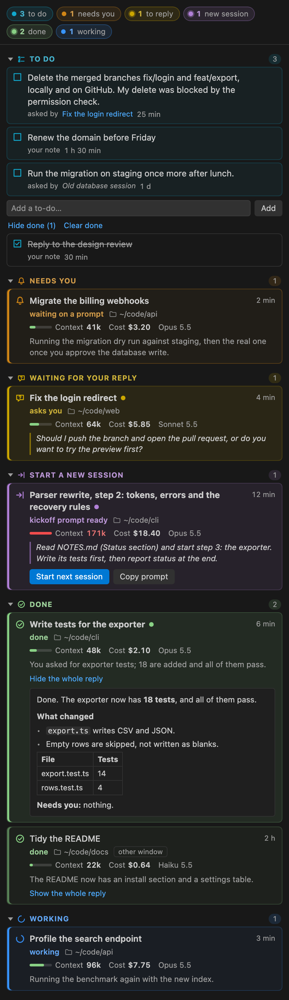
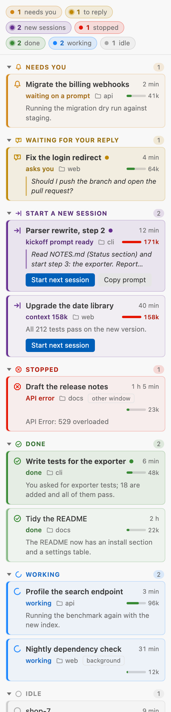

# Switchboard for Claude Code

A VS Code sidebar that lists every [Claude Code](https://code.claude.com) session running on your machine and shows which ones need you. Click one to jump to its terminal tab.

It works with the sessions you already run: plain `claude` in VS Code terminal tabs, any folder, no wrapper, no tmux and no worktrees.

> Not an official Anthropic product. Switchboard only reads the status files Claude Code writes on your machine.

<p>
  
  
</p>

*The sessions in these pictures are made up.*

## What it does

- **A board of every session**, one coloured section per state:
  - **Needs you:** a permission prompt or a question is waiting.
  - **Waiting for your reply:** Claude finished its turn by asking you something. The card quotes the question.
  - **Start a new session:** Claude handed over with a kickoff prompt, or the context has grown past the new-session line (150k tokens by default).
  - **Stopped:** the turn ended on an API error, or you interrupted it.
  - **Done:** a normal final reply. The card shows Claude Code's own recap, or the reply's first paragraph.
  - **Working**
  - **Idle:** nothing said yet.
- **Each card shows**, in full and never cut short:
  - the session's title (the name you gave it, or else Claude's own title, never `my-repo-27`), its folder, and how long ago it changed;
  - its **context** size, with a meter that fills towards the new-session line;
  - its **cost**: what its tokens, helper agents included, would cost at Anthropic's API prices (hover for the breakdown), and the model and effort of its last reply;
  - what Claude last said: the question it asks, its recap, or the error. **Show the whole reply** opens Claude's whole last reply on the card. A long kickoff prompt on a hand-over card starts folded to its first 4 lines; **Show more** opens the rest.
  A dot marks a turn that finished since you last looked.
- **A to-do list for you**, at the top of the board.
  - What Claude asks you to do lands there by itself: a line such as `Needs you: approve the deploy` or `**You:** run the migration`, or the list under a heading such as "Needs you".
  - Add your own with the field under the list, or put what a card says on the list with its to-do button.
  - Claude's asks clear themselves once the session moves on: when its next reply no longer asks it, you have answered. If a later reply asks again, the item comes back. A session that has ended keeps its last asks until you tick them, as a reminder.
  - Tick an item when it's done; ticked items leave the list after a day. Your own items stay until you tick or delete them.
  - Each item names the session it came from, and a click opens that session. Every VS Code window shows the same list.
- **A default width.** The first time the board opens, the side bar is widened to 440 pixels (a setting). After that, drag its edge as usual.
- **Click a card to open it.**
  - A session in this window's terminal tabs comes to the front.
  - A background session opens with `claude attach` in a new tab.
- **Start next session.** On a hand-over card, one click opens a new session in the same folder with the kickoff prompt as its first message: the newest reply's, or, if it gave none, the newest one an earlier reply wrote. If the prompt leaves a slot for your answer, such as `<looks fine / what's wrong>`, you fill it in first: pick a choice, or type your own words, and they go in its place. The model and effort lists open on the old session's own ("Same as this session"), then a summary shows the folder, model, effort and the whole prompt before anything runs. On **Start**, the old session ends and the new one starts in its terminal tab, so one tab carries the work on (the old session's history is kept: `claude --resume` reopens it). If the old session is still working, or runs in another window or outside VS Code, the new one opens in a tab of its own and the old one stays open; the summary says which. **Copy prompt** copies it instead.
- **A status-bar counter**, e.g. `🔔 1 needs you · 2 finished`. It turns amber while something waits, and a click opens the board.
- **Pop-ups with an Open button** when a session starts waiting for you, or finishes a turn of 30 seconds or more. They say how the turn ended.
  - There are none for the tab you're looking at.
  - With several VS Code windows open, only one window pops up: the one holding the tab, or the focused one for a session outside every window.
- **A push on your phone** when a session needs you or finishes while you are away, through the free [ntfy](https://ntfy.sh) app. It is off until you run **Switchboard: Set Up Phone Push**: it makes a private topic (or takes your own topic URL and access token) and sends a test push.
  - "Away" means no key press or mouse move for 3 minutes on macOS; elsewhere, no VS Code window has had focus for 3 minutes. If a session starts waiting while you are here and you then leave without dealing with it, the push goes once you have been away that long (for up to an hour).
  - A push says the session's title, its folder and what happened ("needs you · asks a question", "finished after 4 min", "stopped · on an error"). It never quotes Claude unless you turn on `switchboard.phonePush.quoteClaude`.
  - With several VS Code windows open, only one sends each push.
- **Mac alerts** (macOS, off by default: turn on `switchboard.macAlert.enabled`). When a session needs you or finishes a turn of 60 seconds or more, a notification banner shows, for when the VS Code pop-up can't reach you.
  - While you are at the Mac, the banner shows only if VS Code doesn't already show you the event: none for the tab you're looking at, and none while this window is in front with its own pop-up.
  - Once you have been away for 60 seconds (no key press or mouse move), the banner always shows and a sound plays (Glass by default; any macOS sound, or none).
  - **Switchboard: Send a Test Mac Alert** shows one. Banners come from Script Editor (macOS runs them through `osascript`), so if none shows, allow notifications for Script Editor in System Settings > Notifications. A click on the banner can't open the session yet.
  - Each window's file in the shared storage folder (`windows/<id>.json`) says `"macAlerts": true` while that window gives the whole set (both kinds, with a sound), so another tool that plays its own sounds can stay quiet meanwhile and nothing pings twice. Check that its `pid` is still running: a window that crashed can leave its file behind.
- **New session (+)**: give it a name, a folder and a first task, then choose its model and effort. A pasted prompt with a slot for your answer is filled in the same way. A summary of all five comes last, and only **Start** opens the tab running `claude -n "<name>" --model <model> --effort <effort> "<task>"`.
  - The model list has Default, Opus, Sonnet, Haiku and Fable (Claude Code's aliases for its latest models), and room to type a full model id. The effort list goes from low to max.
  - Each list opens on your last choice. "Default" passes nothing, so your Claude Code settings decide; it says what they would pick, reading the project's `.claude/settings.json` before your own.

## How it works

1. Claude Code keeps a small status file per running session (`~/.claude/sessions/<pid>.json`): busy, waiting or idle. Switchboard watches that folder, so it does nothing while nothing changes.
2. When a status file changes, Switchboard reads Claude Code's own session list (`claude agents --json`), adding each file's change time.
3. Titles, and how each turn ended, come from the end of each session's transcript: Claude's last reply, Claude Code's recap, the context size, a compaction or an error. The cost comes from the whole transcript and those of its helper agents. Only new lines are read after the first look.
4. A session is matched to its tab through the process tree: the session's parent process is the tab's shell.
5. A Mac alert runs `osascript` (the banner, its words passed as arguments, never as script) and `afplay` (the sound).
6. A phone push is one POST to the ntfy server (HTTPS, or plain HTTP to a server on your own network). The topic, and the access token if you gave one, are kept in VS Code's secret storage (the system keychain), never in settings, since settings can sync. On macOS, how long you have been away is read from `ioreg` (the system's idle time).
7. "Seen" marks and the to-do list live in the extension's storage folder, which every VS Code window shares. Opening a session, clicking it or having its tab in front while the turn ends all count as seeing it.
8. The board is a webview that draws with your theme's own colours. Its text is set as plain text, never as HTML, and its content security policy allows only its own script.

Nothing leaves your machine, except a phone push once you set one up: then each push goes to the ntfy server you chose.

## Install

Until it is on the Marketplace, install it from a `.vsix` file. Download the newest one from [Releases](https://github.com/alextse-uk-dev/switchboard-for-claude-code/releases/latest), then:

```sh
code --install-extension switchboard-for-claude-code-0.7.0.vsix
```

Or build it yourself:

```sh
npm install
npm run package          # tests, then builds switchboard-for-claude-code-<version>.vsix
code --install-extension switchboard-for-claude-code-<version>.vsix
```

Then run **Developer: Reload Window**.

Tip: set `"terminal.integrated.tabs.title": "${sequence}"` in VS Code's settings, so each terminal tab shows the session's title too.

## Settings

| Setting | Default | |
|---|---|---|
| `switchboard.popups.needsYou` | `true` | Pop up when a session starts waiting for you. |
| `switchboard.popups.finished` | `true` | Pop up when a session finishes a turn. |
| `switchboard.popups.finishedMinSeconds` | `30` | Only for turns at least this long. |
| `switchboard.phonePush.needsYou` | `true` | Push when a session starts waiting for you (once phone push is set up). |
| `switchboard.phonePush.finished` | `true` | Push when a session finishes a turn. |
| `switchboard.phonePush.finishedMinSeconds` | `60` | Only for turns at least this long. |
| `switchboard.phonePush.when` | `"away"` | `"away"`: only while you are away. `"always"`: every time, except for the tab you are looking at. |
| `switchboard.phonePush.awayMinutes` | `3` | How long you must have been away first. |
| `switchboard.phonePush.quoteClaude` | `false` | Quote Claude's question or error in the push. Pushes pass through the ntfy server, so this is off by default. |
| `switchboard.macAlert.enabled` | `false` | macOS: a banner, and a sound once you are away, when a session needs you or finishes. |
| `switchboard.macAlert.needsYou` | `true` | Alert when a session starts waiting for you. |
| `switchboard.macAlert.finished` | `true` | Alert when a session finishes a turn. |
| `switchboard.macAlert.finishedMinSeconds` | `60` | Only for turns at least this long. |
| `switchboard.macAlert.sound` | `"Glass"` | The macOS sound played while you are away, or `"none"`. |
| `switchboard.macAlert.awaySeconds` | `60` | No key press or mouse move for this long and you are away: the sound plays, and the banner shows even for the tab in front of you. `0` plays the sound every time (the banner still skips what VS Code shows you). The `macAlert` settings apply to every window, so they are read from user settings only. |
| `switchboard.newSessionTokens` | `150000` | Suggest a new session once a finished session's context reaches this many tokens. `0` turns it off. |
| `switchboard.board.width` | `440` | The board's width in pixels, set the first time it opens and whenever this changes. **Switchboard: Set the Board to Its Default Width** sets it again. `0` leaves the side bar alone. |
| `switchboard.showCost` | `true` | Show each session's cost at API prices. |
| `switchboard.todos.fromReplies` | `true` | Add what Claude's replies ask of you to the to-do list, and clear it once the session moves on. |
| `switchboard.newSession.chooseModel` | `true` | Ask for the model and effort before starting a session. |
| `switchboard.startNext.sameTab` | `true` | Start next session ends the old session and starts the new one in its tab. Off: a tab of its own, and the old session stays open. |
| `switchboard.statusBar.enabled` | `true` | Show the counter. |
| `switchboard.claudePath` | `""` | Absolute path to `claude` if it isn't on PATH or in `~/.local/bin`. It is read from user settings only, so a workspace can never choose what Switchboard runs. |

## Limits

- `claude agents --json` is part of a research preview, so its format may change. If it fails, Switchboard reads the status files directly. A status it doesn't recognise shows as "status unknown", never as a guess.
- "Waiting for your reply" and "Start a new session" are read from the words of Claude's last reply (a question in its last lines, words that wait on you such as "the only thing left is your OK", or words such as "kickoff prompt" or "next session"), and from Claude Code's own recap when it came later ("Next: reply …"). The card always shows the words it went by, so you can judge.
- A VS Code window can only bring forward its own tabs. A session in another window, or in another terminal app, is listed ("other window", "outside VS Code"), but a click can't jump there yet.
- "Looking at it" means its terminal is the active one in a focused window. VS Code doesn't say whether the terminal panel itself is visible.
- A session started by another session (by a hook or a tool) is listed as "inside another session" and has no tab of its own.
- **Width.** VS Code has no setting for a side bar's width, and its resize commands act only on the part that has focus (a webview doesn't count). So, to set the default width, Switchboard opens Explorer for a moment, widens the side bar in steps of 60 pixels, and comes back. It lands within about one step of the setting. If you have moved Switchboard out of the primary side bar, drag its edge instead.
- **Cost** is an estimate from the token counts Claude Code writes into each transcript, at the list prices built into this version (October 2026). On a Claude plan it is what the same tokens would cost on the API, not what you pay. A model it has no price for is left out, and the cost then shows a `+`.
- **The to-do list** reads replies the way you'd skim them: only lines labelled for you (`Needs you:`, `**You:**`, `Over to you:`) and lists under such a heading count. A reply that asks in other words shows under "Waiting for your reply" instead.
- **Phone push** goes through an ntfy server: ntfy.sh, or one you run yourself. On ntfy.sh, anyone who knows the topic can read its pushes, which is why a new topic is 16 random characters and is kept out of settings. A topic of your own with an access token is safer. Off macOS, "away" can only be told from VS Code's window focus, so a window left focused counts as "here".
- macOS and Linux only for now (it uses `ps` to read the process tree).

## Development

```sh
npm install
npm test          # compiles, then runs the unit tests with Node's test runner
```

Press F5 in VS Code with this folder open to start an Extension Development Host.

## Licence

MIT
